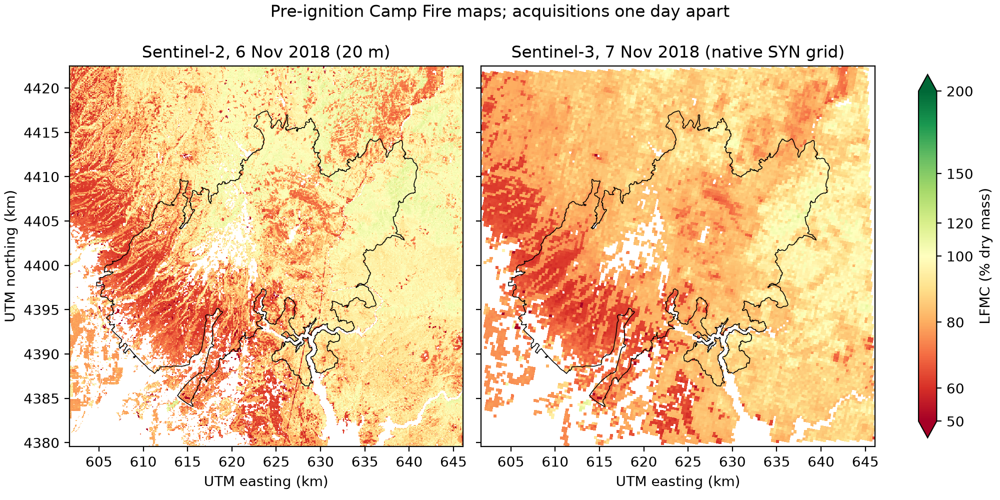

# lfmc-multisensor

Estimate **live fuel moisture content (LFMC)** from satellite surface reflectance,
daily weather and terrain using the models described in the
[published study](https://doi.org/10.3390/rs18213744).

LFMC expresses the mass of water in living vegetation as a percentage of its dry
mass. A value of 100% means equal masses of water and dry material; values above
100% are possible. This package applies the published grass, shrub and tree
Random Forest models to satellite pixels and writes moisture estimates, quality information
and a record of the inputs used.

**Development candidate.** Working examples cover every product below. Current
runs use **WorldCover 2021 by default**, with **2020** selectable independently
of the acquisition year. The three trained models come with the repository.



*Published mapping example: Sentinel-2 on 6 November 2018 and Sentinel-3A on
7 November 2018, at their native grids. Figure A3 of Pampanoni et al. (2026),
[doi:10.3390/rs18213744](https://doi.org/10.3390/rs18213744), reproduced unmodified
under [CC BY 4.0](https://creativecommons.org/licenses/by/4.0/).
This historical paper example uses its own documented inputs; direct runs
use the selected fixed WorldCover snapshot.*

## What you can run

The package downloads optical data and the ancillary inputs needed for a chosen
area and date. It uses AgERA5 daily weather, JAXA AW3D30 v4.1 terrain and annual
ESA WorldCover for selecting the vegetation model. Google Earth Engine is not
required or used.

| Satellite product | Configuration | Output grid | File format |
| --- | --- | --- | --- |
| Sentinel-2 L2A | `s2_l2a` | 20 m; red reflectance averaged from 10 m | GeoTIFF |
| Landsat 8/9 Collection 2 Tier-1 L2 | `landsat_c2l2`, sensor `L8/L9`, `L8`, or `L9` | Native 30 m | GeoTIFF |
| MODIS Terra/Aqua (MOD09A1.061 / MYD09A1.061) | `modis`, sensor `Terra/Aqua MODIS` | Native sinusoidal, about 463 m; nominal 500 m | GeoTIFF |
| Suomi NPP VIIRS VNP09H1.002 | `viirs`, sensor `Suomi NPP VIIRS` | Native sinusoidal, about 463 m; nominal 500 m | GeoTIFF |
| Sentinel-3 SY_2_SYN NTC collection 002 | `s3syn300`, sensor `S3A/S3B`, `S3A`, or `S3B` | Native curved grid with per-pixel coordinates | NetCDF |

MODIS and VIIRS use eight-day composites. Their configured date selects the
weather and calendar predictors within an explicitly selected composite interval;
the reflectance can include observations after that date. Sentinel-2, Landsat
and Sentinel-3 use an actual acquisition date.

The grouped MODIS option searches both Terra and Aqua and produces a separate
map for each selected granule using its spacecraft's calibration.

Optional weather downscaling follows the appendix case-study methodology.
It is **off by default** and uses a documented approximation of the weather
model's reference elevation.
It adjusts weather predictors, not the spatial resolution of satellite reflectance.

## Run with the desktop GUI

After installing and activating the Conda environment, launch:

```text
lfmc-multisensor gui
```

The desktop interface starts with **shapefile selection**. Choose your polygon
file, satellite, date, model directory, cache and output. It reprojects the AOI
from its declared CRS and masks predictions to the polygon union, preserving
holes and multiple features. Bounding-box entry remains available, and
**Point and radius** creates a circular AOI from latitude, longitude and a radius
in kilometres. **Point and square** uses a centre and full side length in km.
The editable filename label defaults to the selected polygon file's name;
you can replace it with your own study label. A clickable paper citation
appears at the bottom right.

**AOI statistics** can summarise saved maps or run automatically after mapping.
Choose means or medians, overall and by Grass/Shrub/Tree, with spatial spread
and coverage figures. CSV/JSON tables and 300 dpi PNG/vector PDF figures are
written locally. Optional exploratory temporal contrast intervals use paired
dates, rather than treating pixels as independent replicates. See the
[statistics guide](docs/guide/statistics.md).

Use **Plan** to inspect the request, **Find scenes** to choose a matching scene,
and **Run** to start processing. Long tasks run in a background process so the
window remains responsive. Downscaling stays off unless you select it.
Optionally set **Max cloud (%)** before searching, or filter the returned scene
list using its cloud-percentage column. Missing percentages appear as **N/A**;
with a maximum set, check **Include unknown cloud cover** to retain them.
These are scene/granule percentages, rather than cloud cover within your AOI.
The [GUI guide](docs/guide/gui.md) explains setup, selection, cancellation and
date ranges and output handling. The same shapefile option works in JSON
through `aoi_path`; see `examples/sentinel2_shapefile_2021.json`.

Leave the optional end date blank to search one complete UTC day. Set it to
search the inclusive date range and process separate maps for the matching
scenes. Each map uses its scene's date for weather; a series manifest records
progress. WorldCover stays fixed at the selected 2021 or 2020 snapshot.

## Start here

The [first-map tutorial](docs/guide/tutorial.md) uses the Sentinel-2 acquisition
from 6 November 2018 in the paper's Camp Fire case study. You will need Conda
and your own provider access. The clone includes the three published model bundles.

Clone the [LFMC multisensor repository on GitHub](https://github.com/valpamp/lfmc-multisensor)
to retrieve the three compressed model files. Follow the
[clone instructions](docs/guide/installation.md#clone-the-repository).
On Windows x64, install [Miniforge](https://github.com/conda-forge/miniforge#windows)
if you need Conda. Open the Miniforge Prompt in your checkout and run these commands.

```text
conda create -n lfmc-multisensor --file environment-win64.lock.txt
conda activate lfmc-multisensor
python -m pip install --require-hashes --no-deps -r requirements-statistics-win64.lock.txt
python -m pip install --no-deps --no-build-isolation .
python -m pip check
```

Run Python and the CLI inside the activated Conda environment. Windows needs
the environment's library paths as well as its Python executable. Model loading
requires **scikit-learn 1.9.0** exactly. See the
[installation guide](docs/guide/installation.md) for environment checks and the
alternative `conda run` invocation.

The loader extracts and verifies the bundles in `model-assets/` on first use. The GUI can
verify them with **Check models** before the first run.

```text
model-assets/
  best_Grass_gapfill_within_site.joblib.bz2
  best_Shrub_gapfill_within_site.joblib.bz2
  best_Tree_gapfill_within_site.joblib.bz2
```

Set up [provider accounts](docs/guide/accounts.md). The first Sentinel-2 map
needs CDSE S3 keys and an AgERA5-enabled Climate Data Store account. Then
launch the GUI or inspect the command-line example.

```text
lfmc-multisensor gui
```

```text
lfmc-multisensor plan examples/sentinel2_camp_fire_2018.json
lfmc-multisensor access-check examples/sentinel2_camp_fire_2018.json
lfmc-multisensor discover examples/sentinel2_camp_fire_2018.json
lfmc-multisensor run examples/sentinel2_camp_fire_2018.json
```

`plan` explains the requested inputs without contacting providers. `access-check`
reports configuration presence; it does not prove that a credential is valid.
`discover` lists matching scenes. If several scenes match, select one explicitly
in `product_ids` before running. The workflow downloads data during `run` and
reuses verified files on subsequent runs.
For an interrupted series, keep the cache and the completed maps. The [GUI
recovery instructions](docs/guide/gui.md#cancel-and-recover) explain how to run
the remaining scenes under a new output label.

## Read the results

For the Sentinel-2 example, `outputs/` contains LFMC, QA and dominant-vegetation
GeoTIFFs and a JSON provenance record. Use QA code **0** to identify valid
predictions. Missing predictions remain no-data. The workflow selects a model
only where the dominant land-cover class is grass, shrub or tree.

Sentinel-3 stores LFMC, QA and two-dimensional latitude/longitude together in
NetCDF, preserving the original geolocation. Output pixel size describes the
satellite grid; it does not give every weather or terrain input that resolution.
The [output guide](docs/guide/outputs.md) explains the variables and quality codes.
New outputs also record model-set and Grass/Shrub/Tree versions, currently
**1.0.0**, with their exact checksums.

## Documentation

- [User guide](docs/guide/index.md): installation through interpretation.
- [Desktop GUI](docs/guide/gui.md): select an AOI shapefile and run without editing JSON.
- [First-map tutorial](docs/guide/tutorial.md): a complete example and optional downscaling.
- [Configuration](docs/guide/configuration.md): area, dates, products, paths and scene selection.
- [Method and validation](docs/guide/method-and-validation.md): what is preserved from the study and what has been tested.
- [Troubleshooting](docs/guide/troubleshooting.md): credentials, unavailable data, downloads and Windows environments.

Each output handles one scene or granule and small, non-crossing areas
no more than one degree across, within 60 degrees south to 60 degrees north.
Geographic coverage, processing baselines and operating systems beyond the
documented examples need further validation. This is retrospective inference;
the examples do not establish real-time availability or independent field accuracy.

## Project updates and feedback

Further research may lead to updates to the LFMC models. Planned work
includes validated support for Sentinel-2C, Sentinel-3C
and additional satellites. We welcome reports from researchers and fire
managers, including results from new study areas and suggestions for improving
the workflow. [Share feedback on GitHub](https://github.com/valpamp/lfmc-multisensor/issues)

## License & Commercial Use

> Required Notice: Copyright (c) 2026 Valerio Pampanoni. Licensed under the PolyForm Noncommercial License 1.0.0 (./LICENSE) and subject to the Terms for Generated Maps and Model Outputs (./OUTPUT_TERMS.md). Commercial use of the models, code, or generated LFMC maps is prohibited without a separate written agreement.

This entire repository—including all pre-trained Random Forest models, map-generation utilities, and documentation—is licensed under the **[PolyForm Noncommercial License 1.0.0](./LICENSE)**, supplemented by the **[Terms for Generated Maps and Model Outputs](./OUTPUT_TERMS.md)**.

* **Free for Research & Fire Management:** Academic researchers, educators, non-profits, and public/government wildfire management agencies may freely clone, modify, and run the models and tools, as well as use and share the resulting LFMC maps for non-commercial and public-safety operations.
* **Commercial Restrictions:** Commercial use of the models, code, **and any generated LFMC maps/outputs** (including paid APIs, commercial SaaS platforms, or paid consulting deliverables) is prohibited without a separate written agreement.
* **Commercial Licensing:** To use these models or their generated maps in a commercial product or service, contact **valerio.pampanoni@protonmail.com** or **valerio.pampanoni@uniroma1.it** to negotiate a commercial license.

The reproduced paper figures and other third-party materials carry their own
licences and attribution notices.

## Models and citation

If you use this repository or its LFMC estimates, please cite:

Pampanoni, V.; Chuvieco, E.; Ferrari, A.; Laneve, G.; Saquella, S. (2026).
**A Unified Multisensor Machine-Learning Framework for Live Fuel Moisture Content
Retrieval.** *Remote Sensing*, **18**(21), 3744.
[https://doi.org/10.3390/rs18213744](https://doi.org/10.3390/rs18213744).

[BibTeX](docs/guide/assets/paper.bib) · [CITATION.cff](CITATION.cff) ·
[Citation and image attribution](docs/guide/citation.md).
`CITATION.cff` identifies the paper as GitHub's preferred repository citation.
Also record the software version/commit and preserve output provenance. No
separate software DOI has been assigned.

Model loading checks the bundle hashes and stored preprocessing metadata.
Use the bundles from the official GitHub checkout. The repository distributes
the trained models, and each user supplies their own provider credentials.
