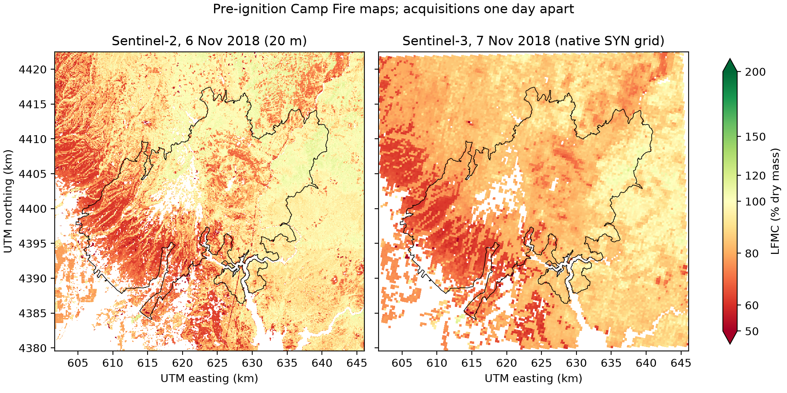

# From satellite observations to a fuel-moisture map

`lfmc-multisensor` estimates live fuel moisture content (LFMC) from satellite
reflectance, weather and terrain. LFMC is water mass as a percentage of dry
vegetation mass: 100% means equal water and dry masses, and values above 100%
are possible. The package applies the
[published vegetation models](https://doi.org/10.3390/rs18213744) to
a chosen area and date, then saves the predictions with quality codes and input
provenance. It does not train a new model during a mapping run.

## Explore LFMC maps online

The **EOSIAL Fire Weather Viewer** lets you explore published 8-day Suomi NPP
VIIRS LFMC maps for the western United States in your browser. It requires no
installation or provider accounts.

<a class="btn btn-primary lfmc-viewer-link" href="https://valpamp.github.io/eosial-viewer/fire-weather/">Open the Fire Weather Viewer</a>

- **Browse and download maps.** Switch between composites, adjust the colour
  palette and opacity, or download a GeoTIFF and view its provenance.
- **Chart a point or area.** Click a pixel to inspect its LFMC estimate and
  use **Show LFMC chart** to see its history. With **Query area time series**,
  drag and release a rectangle or select two opposite corners to chart the mean
  and interquartile range (the 25th–75th percentiles) of valid pixels for each
  composite.
- **Find field sampling locations.** Enable **Globe-LFMC 2.0 sampling sites**
  to see historical field locations and click a marker to identify the site.

## Generate your own maps

Start with the small Sentinel-2 Camp Fire example before changing the area or product.
This gives you a known configuration for checking installation, provider access
and the model files.

Use the [desktop GUI](gui.md) if you prefer selecting a shapefile and filling
in a form. The [command-line tutorial](tutorial.md) walks through the same
processing stages with an explicit JSON request.

*Historical Camp Fire example from Figure A3 of Pampanoni et al. (2026),
reproduced unmodified under CC BY 4.0. See [citation and attribution](citation.md).
Direct workflows use a selected WorldCover 2021 or 2020 snapshot.*

1. [Install in Conda](installation.md) and supply the trusted model bundles.
2. [Configure your provider access](accounts.md).
3. [Make your first map](tutorial.md).
4. [Read LFMC, QA and provenance](outputs.md).
5. [Change the configuration](configuration.md) for another supported example.
6. [Summarise the AOI through time](statistics.md), overall and by vegetation type.

The [method and validation guide](method-and-validation.md) explains how inputs
become predictions, including optional weather adjustment. Consult
[troubleshooting](troubleshooting.md) when a run stops or returns few valid pixels.

The current candidate defaults to WorldCover 2021 for any acquisition year;
2020 is selectable. Enter a single date or an inclusive date range in the GUI.
Range runs produce one map per matching scene and a manifest of completed maps.
Downloads can be substantial even for a small area because some
products require complete source assets. Keep the cache for subsequent runs.
Accounts and model files belong on your machine; they are not supplied by a
documentation website.

## Project updates and feedback

Further research may lead to updates to the LFMC models. Planned work
includes validated support for Sentinel-2C, Sentinel-3C
and additional satellites. Feedback from researchers, fire managers and other
users is welcome. [Share feedback on GitHub](https://github.com/valpamp/lfmc-multisensor/issues)
