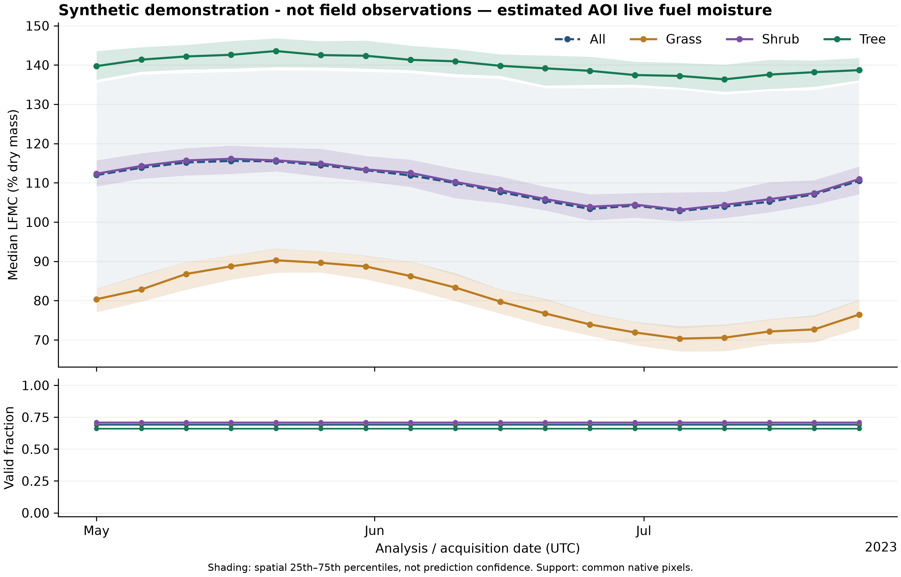
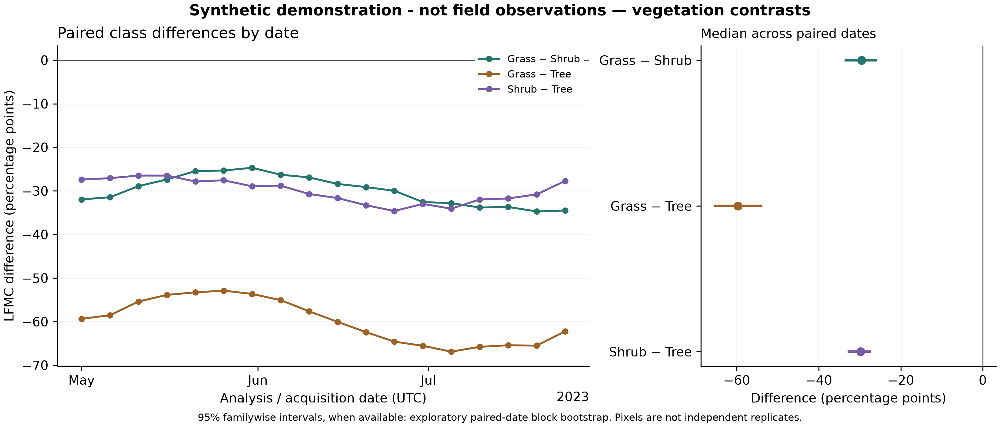

# Summarise LFMC through time

AOI statistics turn a collection of LFMC maps into a table and time-series
figures. You can summarise the whole selected area and separately examine
Grass, Shrub and Tree, using the same dominant vegetation categories that
selected the inference models. The analysis reads saved predictions and QA;
it does not download data or load the model bundles again.



*Synthetic demonstration of the figure format, not field observations. The
lower panel reports the fraction of each group retained on common support.*

## Use the desktop interface

Before a new mapping run, select **Calculate AOI statistics and figures after
mapping**. Open **Statistics options / saved maps…** to choose:

- **Summary line:** median, with a shaded spatial interquartile range; or mean,
  with a shaded band of one spatial standard deviation.
- **Vegetation groups:** retain the overall AOI summary and add Grass, Shrub
  and Tree. An absent or entirely invalid class remains missing, rather than
  receiving an LFMC value of zero.
- **Pixel support:** available valid pixels on each date, or common valid pixels
  across every map. The coverage panel and CSV counts show how much support
  contributes to the summaries.

For an existing run, use the same options window to select its
`<label>_timeseries.json`, a single LFMC GeoTIFF/NetCDF, or a per-map provenance
JSON. Choose the AOI in the main form, set a filename label for the analysis,
then click **Analyse saved outputs**. All completed maps in that source are
analysed; the main date fields govern new mapping, rather than filtering this
saved source. Models and provider credentials are not needed for this action.

Statistics use the current polygon, circle, square or bounding box to select
native pixel centres. The original map's valid footprint still limits coverage;
selecting a larger AOI does not create observations outside it. Multiple features
in a polygon file are treated as their union, as in mapping.

## Available or common support

**Available** summarises the valid pixels independently on each date. It works
with shifted native grids, including different Sentinel-3 overpasses. Cloud
screening and changing coverage can alter which parts of a class contribute,
so read the coverage panel alongside the LFMC curves.

**Common** retains only pixel centres with valid predictions in every map.
This is closest to the fixed-support summaries used in the paper's case studies.
The maps must have identical grids and coordinates, and vegetation routing must
agree on those common pixels. Shifted grids are rejected; no resampling is
performed. A long or cloudy series can leave very few common pixels, or none.
The table reports both available and retained counts.

Summaries give equal weight to native pixel centres. They are not area-weighted
statistics or fractions of pure vegetation cover. Grouping follows the maps'
recorded model-routing categories and land-cover snapshot, rather than applying
the GUI's land-cover selector to the saved maps again. Mixed products, weather
modes, land-cover snapshots or model identities are rejected in one analysis.

## Compare vegetation types

With vegetation groups enabled, the analysis also writes paired-date differences
for Grass minus Shrub, Grass minus Tree and Shrub minus Tree. These differences
are in **LFMC percentage points**. For example, class medians of 90% and 120%
give a difference of −30 percentage points. Their temporal plot helps identify
persistent contrasts and dates when those contrasts change.

The shaded bands on the main figure describe **spatial variability**, not
prediction confidence or statistical significance. Thousands of neighbouring
pixels are not treated as independent replicates.

For an optional exploratory temporal assessment, select **Estimate exploratory
paired-date vegetation contrast intervals**. This selects common support and
vegetation grouping. The calculation resamples blocks of consecutive paired
dates, using a circular block bootstrap, and estimates an interval for the
mean or median across those paired-date differences. The three intervals use
a Bonferroni adjustment for a familywise confidence level of 95%. The method
and end-to-start block construction are described in the
[bootstrap toolkit documentation](https://bashtage.github.io/arch/bootstrap/generated/arch.bootstrap.CircularBlockBootstrap.html).
The package implements the small NumPy resampling calculation directly; that
external toolkit is not a dependency.

Intervals require unique, regularly spaced paired dates, common support and
at least `max(12, 4 × block length)` paired observations. The default block
length is three dates, with 2,000 resamples and recorded random seeds. These
minimums are operational safeguards, not a guarantee of reliable inference.
The method assumes that the paired-difference process is sufficiently stable
over the selected period; that assumption is not automatically established.
Seasonal trends, disturbances and long dependence can make it unsuitable.

The comparison CSV reports interval limits and whether they exclude zero.
This is exploratory evidence about **model-derived temporal contrasts on the
selected common pixels**, conditional on the assumptions. It does not establish
a causal vegetation effect, represent model/field uncertainty or replace
independent LFMC validation. No independent-pixel p-values are calculated.
When requirements fail, the CSV reports the reason and retains descriptive
differences without inventing an interval.

Each source map remains a separate observation. Same-date products are not
silently averaged or mosaicked, and duplicate dates prevent interval estimation.
For that assessment, select one processing product per date when creating the
series, or prepare a source manifest containing the chosen completed maps.



*Synthetic illustration of paired-date contrasts and temporal summary
intervals. These plotted values are a simulation, not a scientific result.*

## Keep the outputs and their support information

The current filename label supplies these names:

| File | Contents |
| --- | --- |
| `<label>_aoi_statistics.csv` | Per-map/group counts, mean, median, sample spatial standard deviation, min/max and 5th/25th/75th/95th percentiles |
| `<label>_aoi_statistics.json` | The same rows, AOI, input checksums, model identity, definitions and comparison settings/results |
| `<label>_aoi_timeseries.png` / `.pdf` | LFMC curves with spatial spread and a valid-coverage panel |
| `<label>_vegetation_differences.csv` | Per-map paired class contrasts |
| `<label>_vegetation_comparisons.csv` | Temporal summaries, optional intervals and eligibility/status information |
| `<label>_vegetation_differences.png` / `.pdf` | Date-by-date contrasts and temporal contrast summaries |

The figures are exported as 300 dpi PNG and vector PDF. Vegetation-difference
files are omitted when grouping is disabled. Existing statistics files are
protected; use another label or output directory for another analysis.

`n` is the number of pixels actually used. `group_pixels` is the selected group
within the map footprint; for **All**, this includes non-routed centres in the
coverage denominator. `available_valid_pixels` counts valid predictions before
the common-support restriction. `valid_fraction` is `n / group_pixels`, not a
fraction of an entire polygon extending beyond the source map.

New affine outputs include `<map>_vegetation.tif`, carrying the exact dominant
class used for routing. Keep it with LFMC, QA and provenance. Sentinel-3 already
stores `dominant_class` in its NetCDF. Earlier standalone GeoTIFFs can use their
original cached land-cover input when its recorded checksum and grid match;
keep the cache selected in the main form. Without that companion or verified
cache, overall summaries remain possible by disabling vegetation grouping.

Statistics on a partial or interrupted series use its completed maps and record
the source status. Missing dates are not interpolated. If automatic statistics
fail after mapping, the completed maps remain available: adjust the analysis
settings and analyse those saved outputs without repeating inference.

## Command line and configuration

To generate statistics after a new run, add:

```json
"statistics": true,
"statistics_by_vegetation": true,
"statistics_centre": "median",
"statistics_support": "available"
```

For saved outputs, add `statistics_source` to a normal AOI configuration, then run:

```text
lfmc-multisensor statistics examples/statistics_saved_series.json
```

That example needs its source and output paths adjusted to your own saved run.
The optional comparison fields are `statistics_comparisons` and
`statistics_block_length`. Computation uses raster windows and temporary
disk-backed quantile buffers, processing one map at a time rather than loading
an image stack into memory.
